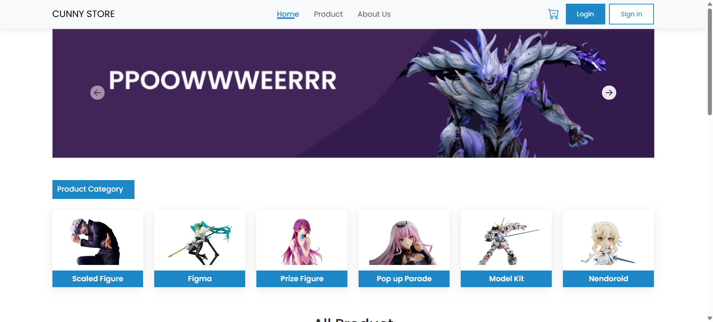
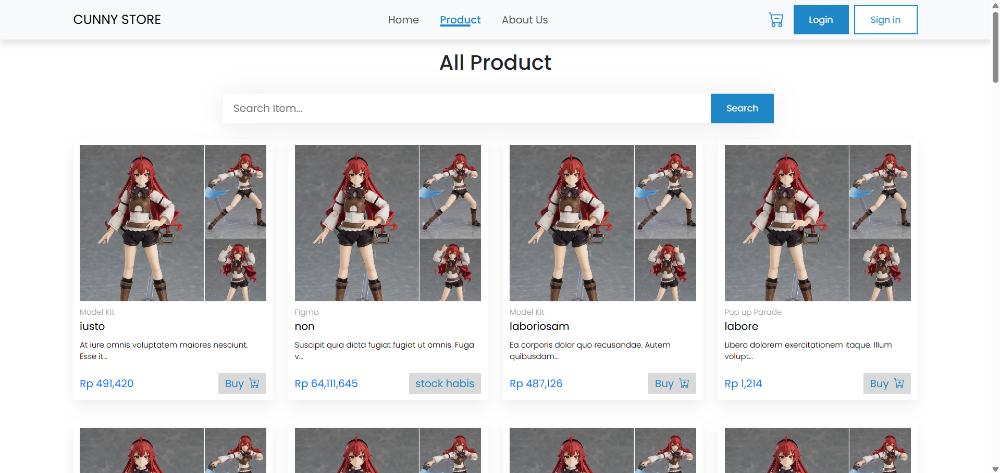
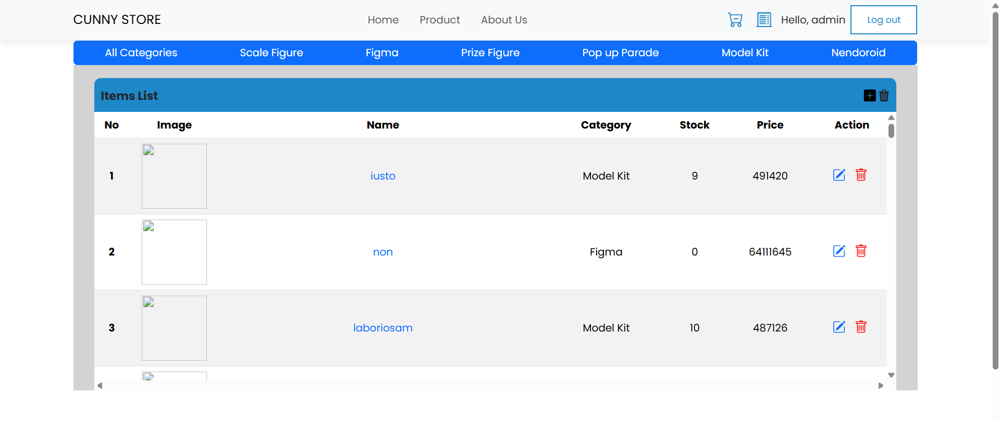
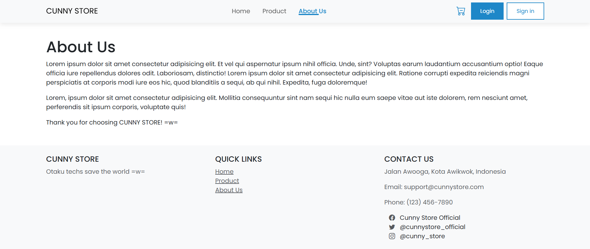
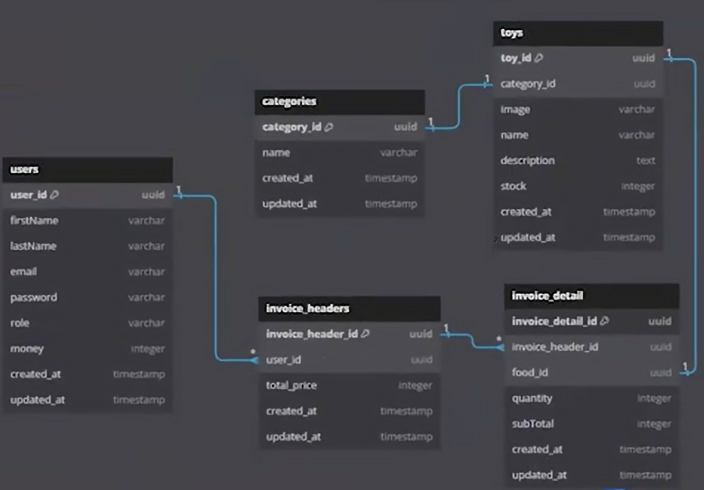
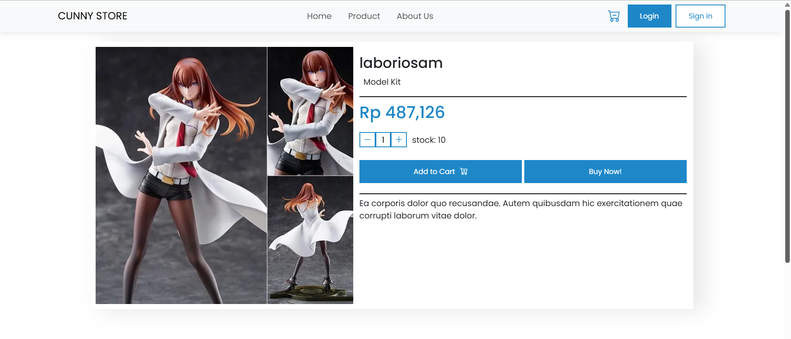
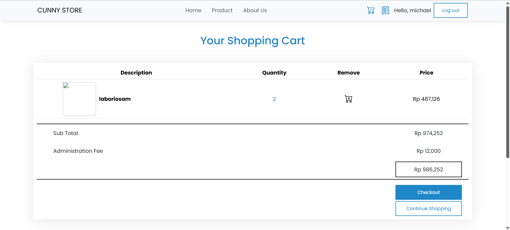
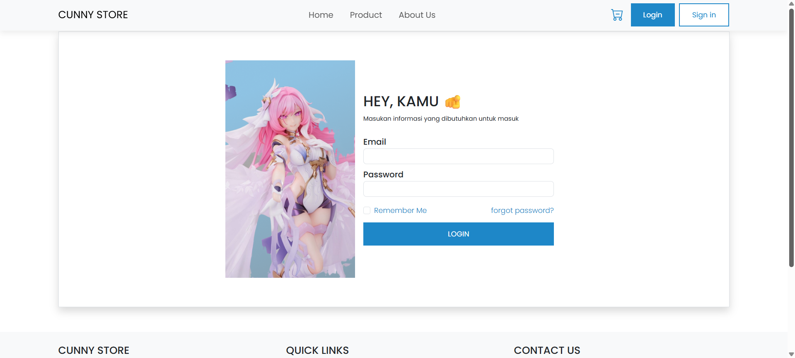
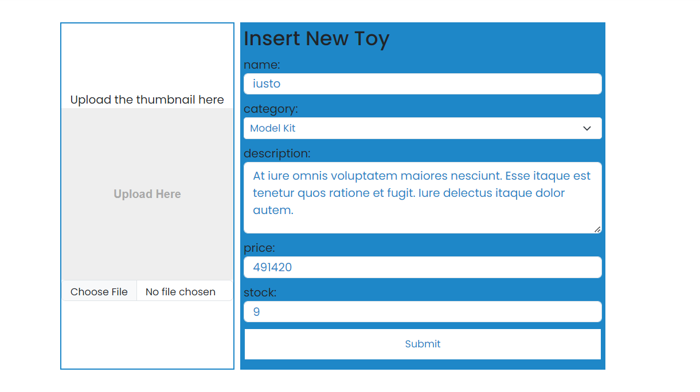

# Final-Project-BNCC
Final Projek dalam kelas Back-End BNCC yaitu membuat website e-commerce dengan tema toko mainan. Website yang kami buat menjual mainan figure dari jepang dengan referensi UI diambil berdasarkan website kyou hobby shop.

# Arsitektur
Website ini memiliki arsitektur sederhana dimana:
1. Front-End: dibuat sederhana menggunakan HTML, CSS, JS dan Bootstrap
2. Back-End: menggunakan framework Laravel
3. Database: database yang digunakan adalah MySQL

# Fitur
- login, register, logout dan remember me
- authentication, authorization, middleware
- form validation request
- CRUD (Create, Read, Update, Delete)
- image handler
- search
- filter
- cart
- invoice

# Scenario
terdapat 3 skenario utama pada website ini:
1. Guest
melihat, mencari dan memfilter halaman dashboard mainan serta melihat detail mainan yang ada
3. User
dapat melakukan hal yang sama dengan Guest tapi memiliki tambahan dapat melakukan pembelian mainan dengan 2 metode:
    - membeli langsung mainan tersebut
    - membeli melalui cart yang ada 
5. Admin
memiliki akses untuk menambah, mengubah dan menghapus mainan yang tersedia

# Contributor
 1. Tohru
 2. Kenzie
 3. Michael
